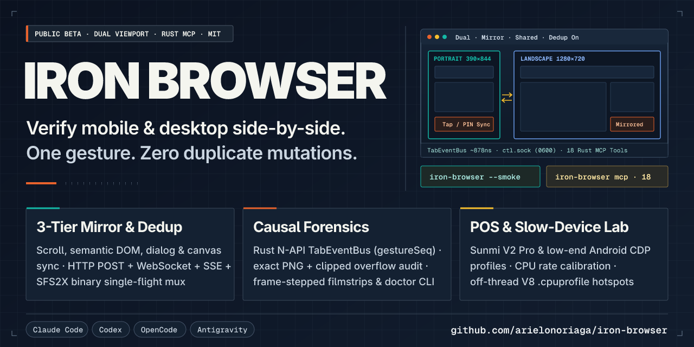
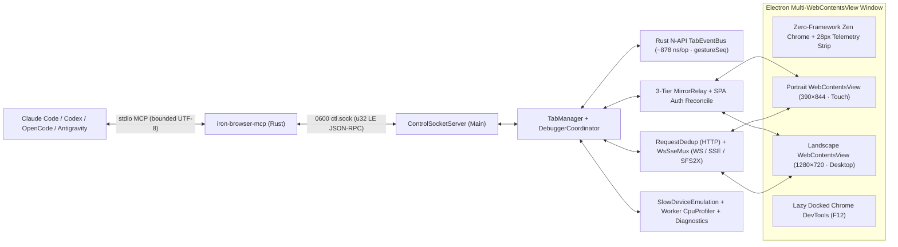

<p align="center">
  
</p>

# IronBrowser

**Dual-viewport (`390×844` Portrait + `1280×720` Landscape) Chromium developer browser, causal Rust `TabEventBus`, and 18-tool `stdio` MCP server for Claude Code, Codex, OpenCode, Cursor, and Antigravity.**

[](#status-public-beta) [](#18-tool-mcp-server-iron-browser-mcp) [](LICENSE) [](#the-iron-stack)

> [!IMPORTANT]
> **Status: Public Beta (`v0.1.0-beta`).** IronBrowser is actively dogfooded daily on Linux (Wayland/X11) across responsive SPAs, POS hardware profiles, and real-time WebGL/WebSocket multiplayer apps. Expect rapid iteration on platform packaging (macOS/Windows) and embedded agent UX as **The Iron Stack** evolves. Bug reports and repro recipes are welcome.

IronBrowser solves two structural blind spots in modern AI-assisted frontend and full-stack verification:

1. **Single-viewport blindness & responsive drift:** Agents and developers verify a fix at desktop width while mobile (`390×844`) silently clips CTAs, breaks modal backdrops, or stalls under constrained POS/mobile CPUs — or they open two separate browser tabs that double-submit `POST` mutations, open duplicate WebSockets, kick each other off single-session game servers, and drift out of auth sync.
2. **Unbounded, non-causal browser MCP logs:** Dumping raw Playwright/DevTools network and console streams blows up agent context windows without linking *which* user click or keystroke caused *which* HTTP replay, WebSocket frame, `sessionStorage` write, route transition, or layout overflow.

IronBrowser runs **Portrait and Landscape live side-by-side inside one native multi-`WebContentsView` Chromium window**, mirrors interaction across both viewports with **single-flight HTTP / WebSocket / SSE / SFS2X binary deduplication**, links every side effect to a **causal `gestureSeq` (`~878 ns/op` in Rust)**, and exposes **18 bounded-byte MCP tools** over a `0600` Unix domain socket.

---

## Why IronBrowser?

| Capability | Single-Tab DevTools / Playwright | Multi-Pane Dev Browsers | **IronBrowser (`Public Beta`)** |
| :--- | :--- | :--- | :--- |
| **Simultaneous Portrait + Landscape (`WebContentsView`)** | Manual resize / separate runs | Yes | **Yes (`390×844` + `1280×720` live at 60fps)** |
| **3-Tier Mirrored Input (Scroll + Semantic DOM + Canvas)** | No | Scroll / basic click | **Yes + Kobalte/Radix/`<dialog>` & PIN keypad sync** |
| **Single-Flight HTTP `POST`/`PUT`/`PATCH`/`DELETE` Dedup** | N/A | No (double-submits mutations!) | **Yes (correlation-ID remapping + gzip/br/deflate)** |
| **WebSocket, SSE & Binary `SFS2X` Multiplexing** | N/A | No (session kicks / 2× streams) | **Yes (1 upstream socket + `1012` owner failover)** |
| **Cross-Viewport `sessionStorage` & Zero-Reload `spa_sync`** | N/A | Rarely | **Yes (`Shared` live sync vs `Isolated` partitions)** |
| **Causal Gesture Forensics (`gestureSeq` Event Bus)** | No | No | **Yes (Rust N-API `TabEventBus`, `~878 ns/op`)** |
| **POS / Slow-Device Lab + Off-Thread `.cpuprofile`** | Manual DevTools clicks | Basic UA / viewport | **Yes (`sunmi-v2-pro`, CPU calibration, Worker profiler)** |
| **Silent Focus-Safe Headless Verification (`--smoke`)** | Separate headless browser | Steals desktop focus | **Yes (invisible offscreen compositor capture)** |
| **Zero-Cloud Bounded-Byte Native Rust MCP (`--max-bytes`)** | Unbounded JSON / Node wrappers | Proprietary / none | **Yes (single Rust binary · 18 tools · `0600` socket)** |

---

## How IronBrowser Works



### Core Architecture Highlights

- **Ultra-Lean Zero-Framework Shell (`app/src/renderer/`):** Pure TypeScript + CSS Zen chrome (collapsible vertical tab rail, single-row `40px` top bar with `Dual`, `Mirror`, `Shared`/`Isolated`, `Dedup`, `Eco`/`HiDPI`, and `Auto-Sleep` pills, `28px` live telemetry strip with frame-time sparkline, Celestial Dark/Light tokens, zero virtual-DOM overhead).
- **Native Rust Node-API `TabEventBus` (`crates/iron-browser-bus` → `iron_browser_bus.node`, `~878 ns/op`):**
  - Per-tab bounded ring buffer (`2048` events/tab) across 13 domains (`gesture`, `navigation`, `http_dedup`, `ws_mux`, `storage`, `download`, `popup`, `callback`, `console`, `network`, `trace`, `mirror`, `lifecycle`) with automatic URL query/hash token redaction.
  - **Causal `gestureSeq` (`1000ms` window):** Links every downstream HTTP replay, WebSocket/SFS2X frame, `sessionStorage` mutation, file download, popup, and SPA route sync back to the originating user or MCP gesture.
  - **Atomic consume-once `claimEffect`:** Deduplicates mirrored `will-download` saves (`reserveSafeDownloadPath` hardened against path traversal, dotfiles, and symlinks) and `window.open` popups across panes.
  - **Live cross-viewport `sessionStorage` replication:** Pre-script `Proxy` shim syncs `setItem`/`removeItem`/`clear` across `Shared` Dual viewports (`512 KB`/origin quota, strict `http`/`https` same-origin gate; `Isolated` `iron-iso-<tabId>` tabs stay hermetically separated).
- **Full-Stack Cross-Viewport Deduplication & Sync (`Dual + Mirror + Shared + Dedup`):**
  1. **3-Tier Mirrored Input (`MirrorRelay`):** Proportional scroll (`Tier 1`), deterministic semantic DOM selectors (`data-testid` → `#id` → `aria-label` → `name` → `role+text` → CSS path, `Tier 2`) with State-Aware Toggle Guard, Kobalte/Radix/native `<dialog open>` backdrop dismissal sync, and `preventDefault` PIN keypad capture, plus normalized `<canvas>` coordinates (`Tier 3`) with `EchoLoopGuard`.
  2. **HTTP Mutation Dedup (`RequestDedupMiddleware`):** CDP `Fetch` interception deduplicating concurrent identical `POST`/`PUT`/`PATCH`/`DELETE` XHR/Fetch calls across panes (stripping 12 volatile correlation keys for matching and remapping follower correlation IDs on replay; decompressing `gzip`/`br`/`deflate`; failing open on `3xx`/`4xx`/`5xx`/streaming).
  3. **Symmetric WebSocket, SSE & SFS2X Binary Multiplexer (`WsSseMux`):** Shares one upstream `WebSocket` or `EventSource` per `(tab, origin, url, protocols)`, omits non-CORS-safelisted SSE preflight headers on cross-origin streams, parses **SmartFoxServer 2X (`SFS2X`)** uncompressed & zlib-compressed binary frames (synthesizing follower Handshake/Login responses, deduplicating binary `Bet`/`Cashout` ExtensionRequests, and promoting slow owners across numbered cluster shards), and fails over cleanly on `1012` owner teardown.
  4. **Zero-Reload SPA Sync & Auth Route Reconciliation (`handleNavSync`):** Converges initial `302` session-token redirects once without mobile/desktop ping-pong, ignores subframe `pushState`, transitions main-frame SPA routes (`spa_sync`) in-page across delegated anchor routers (SvelteKit/Next) and `popstate` routers (React/Vue) without dropping WebSockets, and reconciles diverged auth routes (`spa_auth_reconcile` / `miss_reconcile`).
- **POS & Slow-Device Hardware Emulation + Off-Thread V8 CPU Profiler:**
  - Named hardware profiles (`sunmi-v2-pro` at `360×720` DPR `2`, `6×` CPU, `slow-4g`, `deviceMemory: 2`, `hardwareConcurrency: 4`, Android 7.1 UA; `low-end-android`; and `none` host reset), custom `cpu_rate` (`1..20`), network shaping, `prefers-reduced-motion` / `Save-Data`, and empirical host-to-target CPU benchmark `calibrate`.
  - Non-blocking `browser_profile` (`Profiler.start`/`stop`) harvesting segments across reload/navigation, summarizing bottom-up `selfMs`/`totalMs` hotspots inside a `worker_threads.Worker`, and streaming a `50 MB`-capped `0600` `.cpuprofile` to disk without stalling the Electron main thread.
- **Crash, Hang & Post-Mortem Forensics (`diagnostics.ts` / `browser_health` / `iron-browser doctor`):**
  - Rotated `0600` JSONL log (`~/.local/state/iron-browser/main.log`) with token redaction, local Crashpad `.dmp` minidumps (`RLIMIT_CORE=0` so `systemd-coredump` never wedges `ctl.sock`), `SharedArrayBuffer` + `inspector.Session.connectToMainThread()` stall watchdog + `5s` shutdown watchdog, and offline-capable `iron-browser doctor`.

---

## Quick Install

### Prerequisites
- **Rust** (`cargo`, stable ≥ 1.85)
- **Bun** (`≥ 1.2`)
- **Linux** (Wayland or X11; Ozone auto-detected via `--ozone-platform-hint=auto`)

```bash
git clone https://github.com/arielonoriaga/iron-browser.git
cd iron-browser

# 1. Install dependencies & build native Rust TabEventBus addon + Electron bundles
cd app && bun install && bun run build && cd ..

# 2. Build native Rust MCP server & install ~/.local/bin symlinks + desktop entry
cargo build --release -p iron-browser-mcp
./packaging/install-desktop.sh
```

### Launch & Register MCP

```bash
# Interactive Dual-Viewport desktop browser
iron-browser https://localhost:5173

# Silent offscreen verification (never steals window focus)
iron-browser --smoke

# Post-mortem health, recent RPC logs & Crashpad minidump check (works even when offline)
iron-browser doctor
```

Add `iron-browser` to your MCP client (`~/.claude.json`, Cursor, Codex, OpenCode, or Antigravity):

```json
{
  "mcpServers": {
    "iron-browser": {
      "type": "stdio",
      "command": "iron-browser-mcp",
      "args": []
    }
  }
}
```

Multiple isolated IronBrowser instances can run side-by-side by setting `IRON_BROWSER_SOCKET=$XDG_RUNTIME_DIR/iron-browser/<name>.sock` and `IRON_BROWSER_USER_DATA=~/.cache/iron-browser-<name>`.

---

## 18-Tool MCP Server (`iron-browser-mcp`)

Speaks newline-delimited `stdio` MCP (`2025-06-18` / `2025-03-26` / `2024-11-05`) with strict UTF-8 byte ceilings (`--max-bytes`, default `32768`, max `262144`) and explicit tool safety annotations:

| Tool | Purpose |
| :--- | :--- |
| **`browser_tabs`** | List open/dormant tabs, `mode` (`dual`/`single`), `mirror`, `dedup`, `session`, `dedupCount`, and per-pane `viewportReport` (`sizeMismatch`). |
| **`browser_open`** | Open URL with `mode`, `session` (`shared`\|`isolated`), device presets (`iphone-15`, `sunmi-v2-pro`, `desktop-hd`, …), or custom `W×H` + DPR. |
| **`browser_navigate`** | Navigate tab URL synchronously across Dual panes with `wcLoadStates` + `pendingReloads` readiness tracking. |
| **`browser_screenshot`** | Capture `portrait`, `landscape`, or `both` PNGs with `exact_size`, `highlight_clipped`, `clip`, per-element `clippedItems` overflow audit, and partial timeout recovery. |
| **`browser_metrics`** | Live `gpuProcessCpuPercent` (separated from `gpuExecutionTimeMs`), per-pane CPU%/RAM MB, `rAF` FPS/p95/jank, V8 JS heap, DOM count, `mirrorMiss`, and active `emulation`. |
| **`browser_interact`** | Dispatch trusted Chromium `click` \| `type` \| `scroll` \| `key` \| `hover` by semantic selector or normalized `(x, y)` (opens a causal `gestureSeq`). |
| **`browser_console`** | Bounded console log buffer (`viewport`, `level`, `limit`, `include_incidents`) with URL token redaction. |
| **`browser_network`** | Recent HTTP/WS entries (`filter: "all"\|"failed"\|"4xx"\|"5xx"`, `include_incidents`). |
| **`browser_eval`** | Evaluate JS inside `portrait` or `landscape` under a hard serialized UTF-8 byte ceiling. |
| **`browser_incidents`** | Observational cross-pane failure grouping (`method + sanitizedPath + status` + linked console errors; keeps single-pane JS exceptions distinct). |
| **`browser_repro`** | `save` \| `load` \| `list` \| `delete` \| `open` \| `step` deterministic frame/seed/phase recipes via `window.__ironSceneDriver`. |
| **`browser_filmstrip`** | Step both viewports across frames or a saved recipe and export a metadata-stamped side-by-side PNG filmstrip. |
| **`browser_trace_start`** | Start bounded rolling `rAF` frame-time + User Timing (`performance.mark`/`measure`) capture. |
| **`browser_trace_stop`** | Stop trace and segment frame times into `before` / `during` / `after` mark windows alongside active emulation metadata. |
| **`browser_events`** | Query the Rust `TabEventBus` by `domain`, `viewport`, `since_seq`, or `gesture_seq` for causal end-to-end verification. |
| **`browser_emulate`** | Apply/reset `sunmi-v2-pro`, `low-end-android`, or custom CPU (`1..20×`), network (`slow-4g`, `3g`, `offline`, custom), UA, cores, RAM, and `calibrate`. |
| **`browser_profile`** | Non-blocking V8 CPU profiler (`start`/`stop`) returning bottom-up `selfMs`/`totalMs` hotspots, per-script breakdown, and a `0600` `.cpuprofile` path. |
| **`browser_health`** | Live main-thread event-loop lag, renderer crash/unresponsive state, watchdog stalls, recent `main.log` tail, and Crashpad `.dmp` fallback when offline. |

---

## Design Contracts & Honest Non-Claims

- **Known CDP hardware-emulation limits:** `browser_emulate` applies real Chromium thread duty-cycle CPU throttling (`Emulation.setCPUThrottlingRate`), network shaping, viewport/touch metrics, User-Agent, `navigator.hardwareConcurrency`, and `navigator.deviceMemory` overrides. **CDP cannot cap real OS/V8 process RAM (it will not trigger Android low-memory OOM kills), emulate legacy WebView JS/CSS engine syntax gaps (e.g. missing Chrome 87 APIs), throttle GPU shader fill-rate, or slow down flash/IndexedDB disk I/O.** Validate memory pressure and legacy WebView syntax separately when targeting constrained Android POS hardware.
- **Strict origin & sender isolation:** Shell IPC (`assertShellSender`), preload DOM bridges, `sessionStorage` replication, HTTP dedup, and WS/SSE multiplexing enforce `senderFrame === mainFrame` and strict non-opaque `http`/`https` same-origin parity. Cross-origin or error responses fail open cleanly.
- **Secret redaction by default:** `TabEventBus`, `StructuredLogger`, `CpuProfilerManager` script URLs, and `MirrorMiss` debug payloads scrub sensitive query/hash tokens (`token`, `jwt`, `secret`, `password`, `code`, `api_key`, etc.) and write logs/profiles/sockets with `0600` permissions (`O_NOFOLLOW` symlink checks).

---

## The Iron Stack

IronBrowser is part of **The Iron Stack** — zero-cloud, local-first Rust & TypeScript tools built for high-trust multi-agent engineering:

1. **[`iron-suite`](https://github.com/arielonoriaga/iron-suite) (`Available Now` — `crates.io` + MCP Registry):**
   Zero-cloud SQLite FTS5 + Hybrid Semantic RRF `stdio` MCP memory hub (`iron`), local **Second Brain & Trust Desk Web UI** (`iron ui`), SSH multi-machine memory sharing, and **9 adversarial `iron-*` engineering & UX skills** (`iron-design`, `irondev`, `irondev-review`, `iron-hunt`, `iron-audit`, `iron-debug`, `iron-perf`, `iron-browser`).
2. **`iron-browser` (`Public Beta — This Repo`):**
   Dual-viewport Chromium verification browser, causal Rust `TabEventBus`, single-flight HTTP/WS/SSE/SFS2X deduplication, POS/slow-device lab, and 18-tool Rust MCP server.
3. **`iron-term` (`Coming Soon`):**
   Native **Rust + GPUI** multi-agent terminal and fleet orchestrator (*Alacritty Blade*):
   - **Headless `iron-agentd` Daemon (`portable-pty` + `alacritty_terminal` + SQLite):** Decouples PTY execution from GPU rendering so 20+ concurrent agents (`claude`, `agy`, `codex`, `opencode`, shells) run with **0 off-screen GPU frames**, while idle multi-day sessions hibernate to **`0 MB` live RAM** with 1-line *"where I left off"* checkpoints, `--resume` tokens, and git worktree freshness checks (`dirty` / `behind origin/main`).
   - **90–98% Raw Terminal Pixels (`iron-gpui`):** Zero dashboard card bloat — native `⌘D` split panes, collapsible `236px` monospace **Urgency Whisper Rail** (`NEEDS YOU` · `ACTIVE` · `DORMANT`), and a 1-keystroke **Ghost Action Bar** with *Fix-Before-Destroy* prompt actions (`[1] Run via runq instead`, `[2] Allow`, `[3] Deny`).
   - **Multi-Host SSH + `runq` Thermal & Build-Queue Control + `390px` Tailscale Companion:** Coordinates CPU/RAM slots across workstation and laptop over plain SSH (zero extra open ports), integrates natively with `iron` memory (`iron-suite`) and `iron-browser` (`IRON_BROWSER_SOCKET` + live `browser_events` causal stream), and embeds a zero-dependency `390px` mobile companion for remote approvals on Tailscale.

Companion utilities: **[entropy-hunter](https://github.com/arielonoriaga/entropy-hunter)** · **[lazyfetch](https://github.com/arielonoriaga/lazyfetch)** · **[claude-statusline-bar](https://github.com/arielonoriaga/claude-statusline-bar)**.

---

## Build & Verify

```bash
cargo clippy --workspace --all-targets -- -D warnings
cargo test --workspace --no-fail-fast

cd app
bun run typecheck
bun test
bun run test/e2e/smoke.e2e.ts
```

## License

MIT — Copyright (c) 2026 Ariel Onoriaga.
